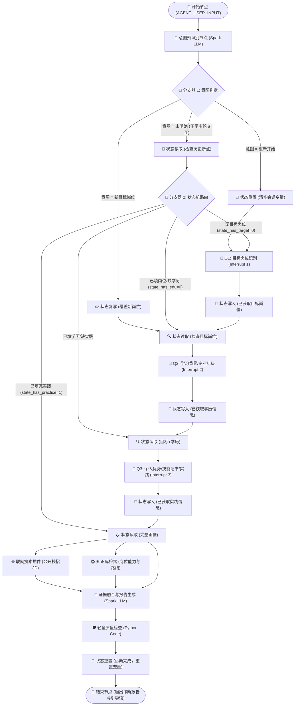

# 职引 · AI职业诊断官 —— 系统架构与工作流设计说明

## 一、系统设计定位与解决痛点

　　「职引 · AI职业诊断官」是面向全国高校在校生与应届毕业生的 AI 就业竞争力诊断智能体。传统大模型职业咨询往往存在三大约束痛点：
1. **单轮幻觉与泛化敷衍**：缺乏结构化画像收集，容易生成“假大空”的通用求职建议；
2. **缺乏多源真实依据支撑**：未对齐实时企业校招 JD 与结构化知识资产，无法精准洞察真实差距；
3. **流程断点不可控与状态丢失**：用户中途修改岗位或提出重新开始时，传统工作流容易发生状态混乱或死锁。

　　针对上述痛点，「职引」基于科大讯飞星辰 Agent 平台搭建了 **22 个节点、28 条连线** 的高内聚状态机工作流，融合 **多轮结构化问答、状态机智能重置与路由、联网实时 JD 搜索、专业 RAG 知识库检索、多源证据融合生成与轻量自动化质量门禁**，打造出具备高可信度、可落地的深度就业诊断闭环。

---

## 二、端到端系统拓扑图 (Mermaid)

---

## 三、核心模块与架构解耦设计

### 1. 意图预识别与状态机驱动引擎 (Nodes 03, 04, 05, 08, 21, 22)
- **前置意图分类**：通过 Spark LLM 零样本分类，精准将用户输入归一为三大类别：
  1. `目标岗位名称`（如“算法工程师”、“产品经理”，保留原词）；
  2. `重新开始`（如“重新诊断”、“从头来”、“清空信息”）；
  3. `未明确`（正常答复、技能描述、日常打招呼）。
- **会话断点恢复与多轮流转**：通过维护 8 大核心会话变量（`state_target_position`, `state_has_target`, `state_major`, `state_grade`, `state_has_edu`, `state_internship`, `state_skills`, `state_has_practice`），分支器 2 自动依据布尔标志位判定当前执行阶段，无缝支持中断、恢复与中途岗位变更（Abort & Switch）。

### 2. 结构化渐进式能力画像采集 (Nodes 06, 07, 09, 10, 11, 12, 13, 14, 15)
- **Q1 目标岗位**：明确用户首选求职方向与岗位边界；
- **Q2 学习背景**：采集毕业院校、专业类别、当前年级与校招时间窗口；
- **Q3 实践与技能**：采集实习经历、核心技术栈/工具熟练度、科研竞赛与项目成果（支持“暂无”兜底，不反复追问阻碍流程）。

### 3. 多源证据融合检索与分析 (Nodes 16, 17, 18)
- **动态联网搜索 (Web Search)**：调用官方联网插件，动态检索目标岗位的最新公开校招 JD、硬性门槛与高频技能要求；
- **专业知识库检索 (RAG)**：关联本地 10 大专业 Markdown 知识库，检索匹配的学习路线、高频面试真题与 STAR 简历要点；
- **报告生成大模型 (Spark LLM)**：执行“用户真实自述 > 公开岗位检索 > 专业知识库 > 模型常识”的严格证据优先级，杜绝凭空捏造与幻觉，生成 6 大章节深度诊断报告。

### 4. 轻量质量安全门禁 (Node 19)
- 运行 Python 脚本对大模型最终输出进行实时校验：
  - 校验六大核心章节完整性（岗位核心能力拆解、能力现状评估、关键差距分析 TOP3、4周行动计划、面试准备建议、整体评分与寄语）；
  - 检查未渲染模板占位符（形如 `{{...}}`）；
  - 检查最小字符长度阈值（>= 1000 字符建议）；
  - 自动剥离思考过程或调试标签，确保交付纯净的 Markdown 报告。

---

## 四、六大能力维度评估体系

报告在“岗位核心能力拆解”与“能力现状评估”中严格围绕 6 项能力维度展开量化打分（1.0~10.0）与准备度评级：
- **S 级 (8.5~10.0)**：关键能力高度达标且具备充分项目/实习证据；
- **A 级 (7.0~8.4)**：大部分关键能力达标，存在少数明确可提升短板；
- **B 级 (5.0~6.9)**：具备一定基础知识，但缺乏核心实践证据；
- **C 级 (1.0~4.9)**：准备明显不足，建议先按周补足基础。
